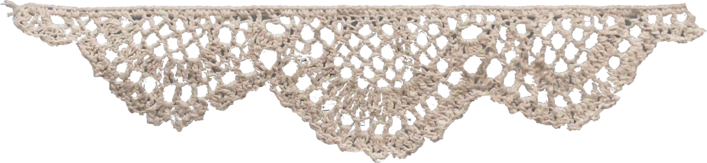
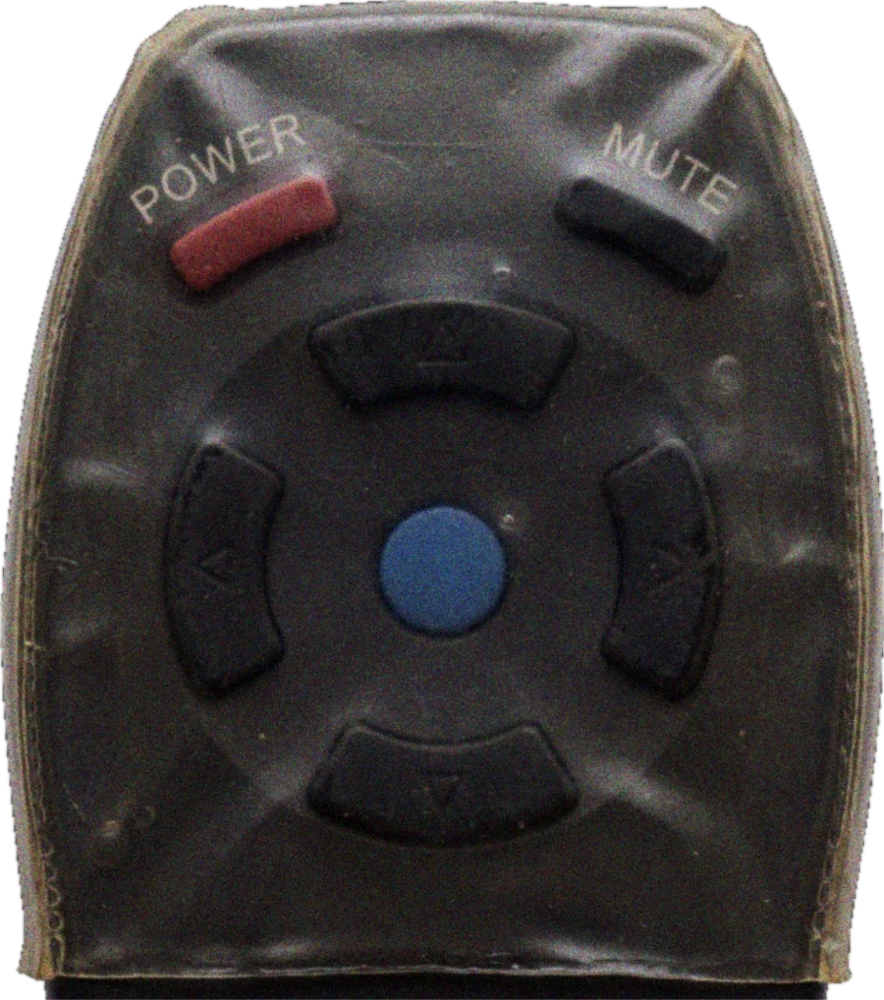

<p align="center">
  
</p>

<h1 align="center">छुट्टी के बाद</h1>
<h2 align="center">CHHUTTI KE BAAD</h2>

<p align="center">
  <strong>School's over. The TV is on. The tiffin can wait.</strong>
  <br />
  A tiny interactive time machine for the golden after-school hours of Indian childhood.
</p>

<p align="center">
  <a href="https://chhutti-ke-baad.vercel.app/"><strong>✦ ENTER THE ROOM</strong></a>
  &nbsp; · &nbsp;
  <a href="#the-experience">Explore the project</a>
  &nbsp; · &nbsp;
  <a href="#run-it-locally">Run locally</a>
</p>

<p align="center">
  
  
  
  
</p>

<p align="center">
  
</p>

<p align="center"><em>Some memories never go offline.</em></p>

---

## The feeling

You get home from school. The bag lands on the floor. The steel tiffin is still in your hand. Somewhere in the room, the ceiling fan is turning, the afternoon light is fading, and the old CRT is waiting.

**Chhutti Ke Baad** is an interactive tribute to that little pocket of time — the 90s and 2000s after-school ritual, recreated as a room you can explore.

## The experience

<table>
  <tr>
    <td width="50%" valign="top">
      
      <h3>The CRT is the main character</h3>
      Watch videos inside a television frame with glass, scanline and power-state details.
    </td>
    <td width="50%" valign="top">
      
      <h3>Pick up the remote</h3>
      Power, mute, volume, channel navigation and the show browser are built into the room.
    </td>
  </tr>
</table>

### Little details worth discovering

- **A room with a mood** — switch between afternoon, evening tubelight and lights-off ambience.
- **A familiar catalogue** — browse nostalgic shows and jump into an episode.
- **The school-day leftovers** — tap the bag, tiffin and other room details for small surprises.
- **Mummy is calling** — stay too long and the most familiar voice in the house might have something to say.
- **Keyboard-friendly controls** — use shortcuts as well as the on-screen remote.
- **Reduced-motion support** — respects the visitor's motion preferences.

## How to play

| Action | Control |
| --- | --- |
| Play / pause | Red power button on the remote |
| Mute / unmute | Mute button |
| Volume | Up / down controls |
| Change channel | Previous / next |
| Browse shows | Centre button |
| Change room lighting | Lighting control |
| Keyboard | Space, ← / →, ↑ / ↓, M, L and B |

## Built with

<p>
  
  
  
  
</p>

- **React** for the interactive room and controls
- **Vite** for development and production builds
- **Tailwind CSS** and custom CSS for styling and atmosphere
- **Lucide** for interface icons
- **YouTube IFrame Player API** for video playback inside the CRT

## Run it locally

You'll need a current Node.js LTS release.

```bash
git clone https://github.com/kirtanswamy/chhutti-ke-baad.git
cd chhutti-ke-baad
npm install
npm run dev
```

For a production build:

```bash
npm run lint
npm run build
npm run preview
```

## Project structure

```text
public/
  assets/                 Room artwork, CRT overlays, remote and sound
  favicon.svg             Project identity
src/
  App.jsx                 Room orchestration and show catalogue
  index.css               Room scene, visual system and motion
  components/
    CrtTelevision.jsx     CRT television
    RoomHeader.jsx        Room lighting and header controls
    StoolAndProps.jsx     Interactive school bag and tiffin props
```

## Deploy

This is a Vite application and is configured for Vercel.

| Setting | Value |
| --- | --- |
| Framework preset | Vite |
| Install command | `npm ci` |
| Build command | `npm run build` |
| Output directory | `dist` |

The live experience: **[chhutti-ke-baad.vercel.app](https://chhutti-ke-baad.vercel.app/)**

## A small note

This project is made with affection for the old television, the steel tiffin, the school bag dropped by the door, and the theme songs we still remember.

<p align="center">
  <strong>Bas 2 minute aur, Mummy. ❤️</strong>
  <br />
  <sub>Made by <a href="https://github.com/kirtanswamy">Kirtan Swamy</a></sub>
</p>
